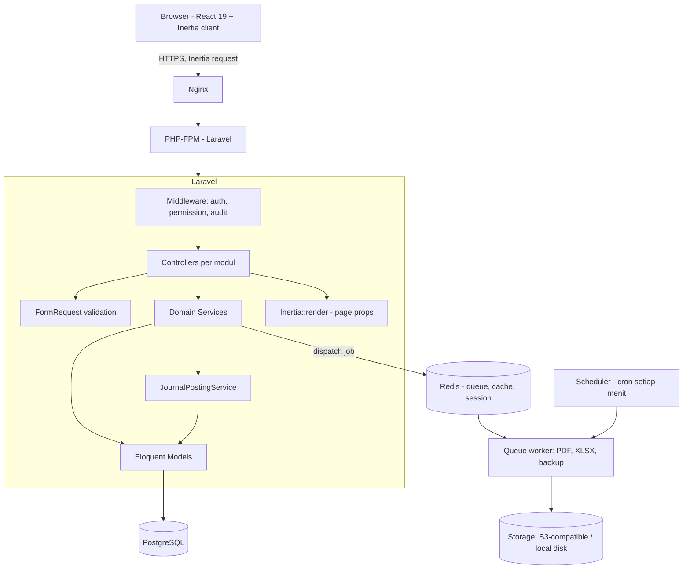
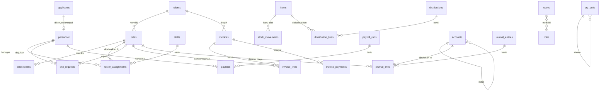
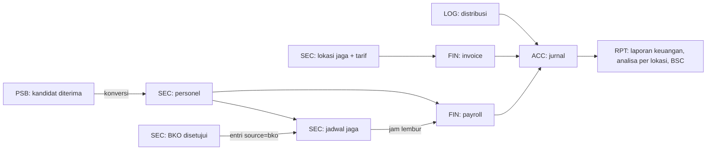

# TECH_SPEC — Garda ERP

| Atribut | Nilai |
|---|---|
| Versi dokumen | 1.0 — 5 Oktober 2026 |
| Kebutuhan produk | [PRD.md](PRD.md) |
| Aturan kerja AI | [SKILL.md](SKILL.md) |
| Rencana implementasi | [TASK.md](TASK.md) |
| Sumber desain | [`Design/`](Design/) (42 berkas) dan [`Skill/`](Skill/) (42 berkas) |

> [!NOTE]
> Nama folder sebenarnya adalah `Design/` dan `Skill/` (huruf kapital, tunggal). Windows tidak membedakan huruf besar-kecil, tetapi server Linux membedakannya. Semua path di dokumen ini memakai nama persis tersebut.

---

## 1. Ringkasan Teknis

Garda adalah monolit Laravel yang merender antarmuka React lewat Inertia.js. Satu basis data PostgreSQL menyimpan data operasional dan akuntansi. Transaksi bisnis (invoice terbit, payroll terposting, distribusi barang, pembayaran) membuat jurnal akuntansi di dalam transaksi database yang sama, sehingga laporan keuangan selalu sinkron dengan operasional.

## 2. Keputusan Arsitektur

Berkas desain tidak menyebutkan stack. Keputusan berikut diambil dari bukti di berkas desain dan kebutuhan di PRD.

| ID | Keputusan | Alasan |
|---|---|---|
| ADR-01 | **Tailwind CSS v4** untuk styling | Nilai token yang diekstrak identik dengan palet bawaan Tailwind (`#9ca3af` = gray-400, `#f59e0b` = amber-500, `#4f46e5` = indigo-600). Format shadow `rgba(0,0,0,0) 0px 0px 0px 0px, …` adalah komposisi ring + shadow khas Tailwind. `color.border.default=#e5e7eb` muncul di 42/42 halaman karena berasal dari preflight Tailwind. Aplikasi referensi hampir pasti dibangun dengan Tailwind, jadi token bisa dipetakan 1:1. |
| ADR-02 | **Laravel** (PHP) sebagai backend monolit | Kebutuhan ERP (RBAC, antrean, backup, PDF, XLSX, audit log) tersedia sebagai paket Laravel yang matang (§4). Satu codebase, satu deploy. |
| ADR-03 | **Inertia.js + React + TypeScript** untuk UI | Komponen interaktif berat (grid jadwal, editor baris jurnal, matriks izin, bagan organisasi) butuh state di klien. Inertia mempertahankan routing dan otorisasi di server tanpa membangun REST API terpisah. |
| ADR-04 | **React Aria Components** sebagai primitif komponen | Aturan [D] mewajibkan perilaku keyboard, pointer, dan sentuh untuk setiap komponen interaktif. React Aria menyediakan ketiganya plus atribut ARIA yang sudah diuji, tanpa gaya bawaan, jadi token Tailwind tetap menjadi satu-satunya sumber gaya. |
| ADR-05 | **PostgreSQL** | Constraint `CHECK`, tipe `numeric` untuk uang, CTE rekursif untuk hierarki akun dan struktur organisasi. |
| ADR-06 | Route referensi dipertahankan persis | Paritas dengan 42 halaman referensi, termasuk `/finance/invoice/new` (tunggal) dan `/logistics/items/detail/{id}`. Alias dicatat di §10.2. |
| ADR-07 | Jurnal dibuat di backend, tidak pernah dari klien | Integritas G-5 dan G-6 di PRD. Klien hanya mengirim input bisnis; service membentuk baris debit-kredit. |
| ADR-08 | Satu tema gelap, tanpa tema terang di v1 | 42/42 halaman referensi bertema gelap. |

## 3. Arsitektur Sistem



### 3.1 Lapisan Backend

| Lapisan | Lokasi | Tanggung Jawab | Larangan |
|---|---|---|---|
| Route | `routes/web.php` | Memetakan URL ke controller, memasang middleware izin | Tidak berisi logika |
| FormRequest | `app/Http/Requests/{Modul}/` | Validasi input dan pesan error berbahasa Indonesia | Tidak menulis ke DB |
| Controller | `app/Http/Controllers/{Modul}/` | Memanggil service, mengembalikan `Inertia::render` atau redirect | Tidak menghitung angka bisnis |
| Service | `app/Services/{Modul}/` | Aturan bisnis, transaksi DB, memanggil `JournalPostingService` | Tidak tahu tentang HTTP |
| Model | `app/Models/` | Relasi, cast, scope query | Tidak memanggil service |
| Query laporan | `app/Reports/` | Query agregat laporan keuangan | Hanya baca |

## 4. Dependensi Sistem

### 4.1 Runtime

| Komponen | Versi Minimum | Fungsi |
|---|---|---|
| PHP | 8.3 | Runtime backend (ekstensi: `pdo_pgsql`, `intl`, `gd`, `zip`, `bcmath`, `redis`) |
| Composer | 2.7 | Manajer paket PHP |
| Node.js | 22 LTS | Build aset frontend |
| PostgreSQL | 16 | Basis data utama |
| Redis | 7 | Antrean, cache, sesi |
| Nginx | 1.24 | Web server dan reverse proxy |
| `pg_dump` / `pg_restore` | sama dengan versi server | Dipakai `spatie/laravel-backup` |

### 4.2 Paket Backend (Composer)

| Paket | Versi | Dipakai Untuk | Modul |
|---|---|---|---|
| `laravel/framework` | ^12.0 | Framework | Semua |
| `inertiajs/inertia-laravel` | ^2.0 | Adapter Inertia | Semua |
| `tightenco/ziggy` | ^2.0 | Nama route Laravel di TypeScript | Semua |
| `spatie/laravel-permission` | ^6.0 | Role dan izin | SET, semua route |
| `spatie/laravel-activitylog` | ^4.0 | Log aktivitas (AC-G-11) | Semua aksi tulis |
| `spatie/laravel-backup` | ^9.0 | Backup DB + file, retensi 30 hari | SET-08 |
| `barryvdh/laravel-dompdf` | ^3.0 | PDF invoice, slip gaji, laporan | FIN, RPT |
| `maatwebsite/excel` | ^3.1 | Ekspor XLSX | RPT, SET-08 |
| `simplesoftwareio/simple-qrcode` | ^4.2 | QR checkpoint | SEC-07 |
| `pestphp/pest` (dev) | ^3.0 | Unit dan feature test | Semua |
| `larastan/larastan` (dev) | ^3.0 | Analisis statis level 6 | Semua |
| `laravel/pint` (dev) | ^1.0 | Format kode PHP | Semua |

### 4.3 Paket Frontend (npm)

| Paket | Versi | Dipakai Untuk |
|---|---|---|
| `react`, `react-dom` | ^19.0 | UI |
| `@inertiajs/react` | ^2.0 | Klien Inertia, `useForm` |
| `typescript` | ^5.6 | Tipe statis |
| `vite`, `laravel-vite-plugin` | ^6.0 / ^1.0 | Build |
| `tailwindcss`, `@tailwindcss/vite` | ^4.0 | Styling berbasis token |
| `react-aria-components` | ^1.5 | Primitif komponen aksesibel (ADR-04) |
| `@tanstack/react-table` | ^8.20 | Tabel data: sortir, kolom, seleksi baris |
| `d3-hierarchy` | ^3.1 | Tata letak bagan organisasi SET-02 (dirender sebagai SVG oleh React) |
| `lucide-react` | ^0.450 | Ikon |
| `vitest`, `@testing-library/react`, `jsdom` (dev) | ^2.1 / ^16 / ^25 | Unit test komponen |
| `@playwright/test`, `@axe-core/playwright` (dev) | ^1.48 / ^4.10 | E2E, keyboard, aksesibilitas |
| `eslint`, `typescript-eslint`, `eslint-plugin-jsx-a11y` (dev) | ^9 / ^8 / ^6.10 | Lint |

## 5. Struktur Direktori

```text
ERP 2/
├── PRD.md  TECH_SPEC.md  SKILL.md  TASK.md
├── Design/                      # 42 spesifikasi desain per halaman (jangan dihapus/diubah)
├── Skill/                       # 42 skill desain per halaman (jangan dihapus/diubah)
├── .agents/skills/anti-slop/    # skill kualitas tulisan, kode, desain
├── app/
│   ├── Enums/                   # PersonnelStatus, InvoiceStatus, AccountCategory, ...
│   ├── Http/Controllers/{Auth,Dashboard,Security,Recruitment,Logistics,Finance,Accounting,Reports,Settings}/
│   ├── Http/Requests/{modul yang sama}/
│   ├── Models/
│   ├── Reports/                 # BalanceSheetQuery, ProfitLossQuery, CashFlowQuery, ...
│   └── Services/{Security,Recruitment,Logistics,Finance,Accounting}/
├── database/
│   ├── migrations/
│   └── seeders/                 # RolePermissionSeeder, ChartOfAccountsSeeder, ShiftSeeder, DemoSeeder
├── resources/
│   ├── css/
│   │   ├── app.css              # @import "tailwindcss"; @import "./tokens.css";
│   │   └── tokens.css           # SATU-SATUNYA tempat nilai hex (§9.2)
│   └── js/
│       ├── Components/ui/       # Button, TextField, DataTable, Badge, Modal, ... (§9.4)
│       ├── Components/domain/   # RosterGrid, JournalLinesEditor, PermissionMatrix, OrgChart
│       ├── Layouts/             # AppLayout (sidebar), GuestLayout (login)
│       ├── Pages/               # satu berkas per halaman (§10, kolom "Komponen Halaman")
│       ├── lib/                 # format.ts (Rupiah, tanggal id-ID), permissions.ts
│       └── types/
├── routes/web.php
├── scripts/lint-tokens.mjs      # penegak aturan token (§9.6)
└── tests/
    ├── Feature/  Unit/          # Pest
    ├── js/                      # Vitest
    └── e2e/                     # Playwright + axe
```

## 6. Model Data

### 6.1 Diagram Relasi



### 6.2 Tabel Inti

Semua tabel memiliki `id` (bigint), `created_at`, `updated_at`. Tabel master memiliki `deleted_at` (soft delete). Uang: `numeric(18,2)`. Kuantitas: `numeric(12,2)`.

| Tabel | Kolom Penting | Constraint |
|---|---|---|
| `institution_settings` | `name`, `license_number`, `npwp`, `address`, `phone`, `email`, `logo_path`, `vat_rate`, `bpjs_kes_rate`, `bpjs_tk_rate`, `overtime_hourly_rate` | Tepat 1 baris |
| `org_units` | `name`, `title`, `parent_id`, `sort_order` | `parent_id` tidak membentuk siklus (dicek di service) |
| `personnel` | `nik`, `full_name`, `birth_place`, `birth_date`, `gender`, `address`, `phone`, `email`, `kta_number`, `kta_expires_at`, `gada_level`, `gada_cert_number`, `position`, `joined_at`, `status`, `site_id`, `bank_name`, `bank_account`, `photo_path`, `base_salary`, `allowance`, `applicant_id` | `nik` unik; `status` ∈ {active, leave, inactive}; `gada_level` ∈ {pratama, madya, utama} |
| `clients` | `name`, `npwp`, `billing_address`, `pic_name`, `pic_phone`, `pic_email`, `contract_ends_at` | `name` unik |
| `sites` | `client_id`, `name`, `address`, `latitude`, `longitude`, `guards_per_shift`, `monthly_rate_per_guard`, `status` | `guards_per_shift` ≥ 1 |
| `checkpoints` | `site_id`, `code`, `name`, `sequence` | `code` unik; (`site_id`, `sequence`) unik |
| `shifts` | `code`, `name`, `starts_at`, `ends_at` | Seed: pagi 07:00–15:00, siang 15:00–23:00, malam 23:00–07:00 |
| `roster_assignments` | `personnel_id`, `site_id`, `shift_id`, `date`, `source`, `bko_request_id` | (`personnel_id`, `date`, `shift_id`) unik; `source` ∈ {plot, bko} |
| `bko_requests` | `personnel_id`, `from_site_id`, `to_site_id`, `shift_id`, `starts_on`, `ends_on`, `reason`, `status`, `requested_by`, `decided_by`, `decided_at`, `decision_note` | `ends_on` ≥ `starts_on`; `status` ∈ {pending, approved, rejected} |
| `applicants` | `nik`, `full_name`, `birth_date`, `address`, `phone`, `email`, `status`, `test_scheduled_at`, `reviewer_notes` | `status` ∈ {new, screening, accepted, rejected} |
| `items` | `code`, `name`, `category`, `unit`, `size`, `min_stock`, `unit_price`, `stock_on_hand`, `notes` | `code` unik; `stock_on_hand` ≥ 0 |
| `stock_movements` | `item_id`, `type`, `quantity`, `balance_after`, `reference_type`, `reference_id`, `occurred_at`, `note` | `type` ∈ {in, out, adjust}; tidak bisa diubah setelah dibuat |
| `distributions` / `distribution_lines` | `number`, `distributed_at`, `recipient_type`, `recipient_id`, `note` / `item_id`, `quantity` | `recipient_type` ∈ {personnel, site} |
| `invoices` | `number`, `client_id`, `period`, `issued_at`, `due_at`, `status`, `subtotal`, `vat_rate`, `vat_amount`, `total`, `journal_entry_id` | `number` unik; `status` ∈ {draft, issued, paid, void} |
| `invoice_lines` | `invoice_id`, `site_id`, `description`, `guards`, `rate`, `amount` | `amount` = `guards` × `rate` |
| `invoice_payments` | `invoice_id`, `paid_at`, `amount`, `cash_account_id`, `journal_entry_id` | Total pembayaran ≤ `invoices.total` |
| `payroll_runs` / `payslips` | `period`, `site_id`, `status`, `journal_entry_id` / `personnel_id`, `base_salary`, `allowance`, `overtime`, `bpjs_kes`, `bpjs_tk`, `pph21`, `net_pay` | (`period`, `site_id`) unik; `status` ∈ {draft, posted} |
| `accounts` | `code`, `name`, `category`, `normal_balance`, `parent_id`, `cash_flow_group`, `is_active`, `is_system` | `code` unik; `category` ∈ {asset, liability, equity, revenue, expense}; `cash_flow_group` ∈ {cash, operating, investing, financing} |
| `journal_entries` | `number`, `date`, `reference`, `description`, `source_type`, `source_id`, `status`, `posted_at`, `reversal_of_id` | `number` unik; `status` ∈ {draft, posted} |
| `journal_lines` | `journal_entry_id`, `account_id`, `debit`, `credit`, `memo`, `site_id` | `CHECK (debit >= 0 AND credit >= 0 AND (debit = 0) <> (credit = 0))` |

### 6.3 Akun Sistem (Seed `ChartOfAccountsSeeder`)

Akun bertanda `is_system = true` dipakai oleh posting otomatis dan tidak dapat dihapus atau dinonaktifkan.

| Kode | Nama | Kategori | Saldo Normal | Grup Arus Kas |
|---|---|---|---|---|
| 1-1100 | Kas | asset | debit | cash |
| 1-1200 | Bank | asset | debit | cash |
| 1-1300 | Piutang Usaha | asset | debit | operating |
| 1-1400 | Persediaan Perlengkapan | asset | debit | operating |
| 2-1100 | Utang Gaji | liability | kredit | operating |
| 2-1200 | Utang PPh 21 | liability | kredit | operating |
| 2-1300 | Utang BPJS | liability | kredit | operating |
| 2-1400 | PPN Keluaran | liability | kredit | operating |
| 2-1500 | Utang Usaha | liability | kredit | operating |
| 3-1000 | Modal Disetor | equity | kredit | financing |
| 3-2000 | Laba Ditahan | equity | kredit | financing |
| 3-9000 | Ekuitas Saldo Awal | equity | kredit | financing |
| 4-1000 | Pendapatan Jasa Pengamanan | revenue | kredit | operating |
| 5-1000 | Beban Gaji Personel | expense | debit | operating |
| 5-2000 | Beban Perlengkapan Jaga | expense | debit | operating |

## 7. Otorisasi (RBAC)

Izin memakai format `{modul}.{aksi}` dengan `aksi` ∈ {`view`, `manage`}. `manage` mencakup buat, ubah, hapus, posting, dan setujui. Middleware `permission:` dipasang per grup route.

| Modul Izin | `view` membuka | `manage` menambahkan |
|---|---|---|
| `security` | SEC-01, 03, 05, 07, 08, 10 | SEC-02, 04, 06, 09; aksi setujui/tolak BKO; CRUD checkpoint |
| `recruitment` | PSB-01, PSB-02 (baca) | Ubah status, terima/tolak, konversi ke personel |
| `logistics` | LOG-01, LOG-03 | LOG-02, LOG-04, LOG-05, barang masuk, penyesuaian stok |
| `finance` | FIN-01, FIN-03 (baca), unduh PDF | FIN-02, terbitkan/batalkan invoice, catat pembayaran, hitung dan posting payroll |
| `accounting` | ACC-01, ACC-03 | ACC-02, ACC-04, posting dan jurnal pembalik |
| `reports` | RPT-01 s.d. RPT-08 | Ekspor PDF/XLSX |
| `users` | SET-03, SET-05 | SET-04, SET-06, SET-07, nonaktifkan pengguna |
| `institution` | SET-01, SET-02 (baca) | Ubah identitas dan struktur, SET-08 (backup, pulihkan, ekspor) |

`/login` terbuka untuk tamu. `/dashboard` terbuka untuk semua pengguna yang login; kartu disaring berdasarkan `*.view` (PRD FR-AUTH-4).

| Role Seed | Izin |
|---|---|
| Administrator Sistem | Semua 16 izin |
| Manajer Operasional | `security.*`, `recruitment.view`, `logistics.view`, `reports.view` |
| Staf Rekrutmen | `recruitment.*`, `security.view` |
| Staf Logistik | `logistics.*`, `security.view` |
| Staf Keuangan | `finance.*`, `security.view`, `reports.view` |
| Akuntan | `accounting.*`, `reports.*`, `finance.view` |
| Direksi | `reports.view`, `security.view`, `finance.view`, `accounting.view`, `logistics.view` |

## 8. Integrasi Antar Modul

### 8.1 Peta Posting Jurnal Otomatis

Semua posting dilakukan oleh `App\Services\Accounting\JournalPostingService::post(JournalDraft $draft)`. Method ini menolak draf yang tidak seimbang dengan `UnbalancedJournalException` dan berjalan di dalam `DB::transaction` milik service pemanggil.

| Kejadian | Service Pemanggil | Debit | Kredit | Dimensi `site_id` |
|---|---|---|---|---|
| Invoice diterbitkan | `InvoiceService::issue` | 1-1300 Piutang Usaha (total) | 4-1000 Pendapatan (subtotal per baris), 2-1400 PPN Keluaran (PPN) | Per baris pendapatan |
| Pembayaran invoice | `InvoiceService::recordPayment` | 1-1100 / 1-1200 (jumlah) | 1-1300 Piutang Usaha | — |
| Invoice dibatalkan | `InvoiceService::void` | Jurnal pembalik dari jurnal terbit | | Sama dengan jurnal asal |
| Payroll diposting | `PayrollService::post` | 5-1000 Beban Gaji (bruto) | 2-1100 Utang Gaji (neto), 2-1200 Utang PPh 21, 2-1300 Utang BPJS | `personnel.site_id` per slip |
| Barang masuk | `StockService::receive` | 1-1400 Persediaan | 2-1500 Utang Usaha atau 1-1100 Kas | — |
| Stok awal item baru | `ItemService::register` | 1-1400 Persediaan | 3-9000 Ekuitas Saldo Awal | — |
| Distribusi barang | `DistributionService::distribute` | 5-2000 Beban Perlengkapan | 1-1400 Persediaan (qty × `unit_price`) | Lokasi penerima, atau `site_id` personel penerima |

### 8.2 Alur Data Operasional



### 8.3 Sumber Data Laporan

| Laporan | Sumber | Aturan |
|---|---|---|
| Buku Besar (RPT-01) | `journal_lines` terposting per akun | Saldo awal = akumulasi sebelum tanggal mulai |
| Buku Pembantu Piutang (RPT-02) | `invoices` + `invoice_payments` per klien | Saldo akhir wajib = saldo 1-1300 (AC-RPT-4) |
| Laba Rugi (RPT-03) | Akun `revenue` dan `expense` dalam periode | Laba bersih = pendapatan − beban |
| Neraca (RPT-04) | Akun `asset`, `liability`, `equity` per tanggal + laba berjalan | Aset = Liabilitas + Ekuitas (AC-RPT-1) |
| Perubahan Ekuitas (RPT-05) | Akun `equity` + laba bersih periode | Laba = RPT-03 (AC-RPT-2) |
| Arus Kas (RPT-06) | Metode tidak langsung dari `cash_flow_group` | Selisih kas = perubahan akun `cash` (AC-RPT-3) |
| Analisa Manajemen (RPT-07) | `journal_lines` dikelompokkan per `site_id` | Margin per lokasi = pendapatan − beban gaji − beban perlengkapan |
| Balanced Scorecard (RPT-08) | Agregat lintas modul (PRD FR-RPT-9) | Target KPI disimpan di `institution_settings` |

## 9. Implementasi Sistem Desain

### 9.1 Status Berkas Sumber

- `Design/{Halaman}.md` dan `Skill/{Halaman}.md` berpasangan 1:1 dan memiliki token yang identik. `Design/` menambahkan kepadatan komponen dan diagnostik ekstraksi. `Skill/` menambahkan frontmatter skill (`name: design-system-…`).
- Satu pasangan berbeda nama: `Design/Data Personel.md` ↔ `Skill/Data Personil Security.md`.
- Token diekstrak per halaman secara otomatis, jadi **peran** warna tidak konsisten antarhalaman (contoh: `color.surface.muted` bernilai `#030712` di Dashboard dan `#ffffff` di Plotting Jadwal Baru). **Nilai** warnanya konsisten. Karena itu §9.2 mengonsolidasikan berdasarkan nilai dan frekuensi kemunculan, bukan nama peran hasil ekstraksi.

### 9.2 Token Global Terkonsolidasi

Berkas `resources/css/tokens.css` adalah satu-satunya tempat nilai mentah. Palet bawaan Tailwind dimatikan agar kelas seperti `bg-gray-900` tidak tersedia.

```css
@theme {
  --color-*: initial;

  /* Permukaan */
  --color-canvas: #000000;          /* surface.base, 42/42 halaman */
  --color-sunken: #030712;          /* gray-950: sidebar, latar tabel */
  --color-raised: #111827;          /* gray-900: kartu, panel, modal */
  --color-overlay: #1f2937;         /* gray-800: hover baris, dropdown */

  /* Teks */
  --color-fg-strong: #f3f4f6;       /* gray-100: judul, nilai data */
  --color-fg: #9ca3af;              /* gray-400: teks badan, label */
  --color-fg-muted: #94a3b8;        /* slate-400: teks bantuan, metadata */
  --color-fg-disabled: #64748b;     /* slate-500: HANYA state disabled */
  --color-fg-on-accent: #030712;    /* teks di atas aksen amber */
  --color-fg-on-solid: #ffffff;     /* teks di atas indigo-600 dan red-600 */

  /* Garis */
  --color-line-subtle: #1f2937;     /* pembatas dekoratif: baris tabel, tepi kartu */
  --color-line-input: #6b7280;      /* tepi field input dan checkbox */

  /* Aksen dan status */
  --color-accent: #f59e0b;          /* amber-500: aksi utama, fokus, menu aktif */
  --color-accent-hover: #fbbf24;    /* amber-400 */
  --color-accent-pressed: #d97706;  /* amber-600: state active (tombol login referensi) */
  --color-accent-soft: #fffbeb;     /* amber-50: latar badge peringatan */
  --color-accent-soft-fg: #92400e;  /* amber-800: teks di atas accent-soft */
  --color-info-solid: #4f46e5;      /* indigo-600: latar tombol sekunder/ badge info */
  --color-info: #3b82f6;            /* blue-500: teks/ikon informasi */
  --color-success-soft: #d1fae5;    /* emerald-100: latar badge disetujui */
  --color-success-soft-fg: #065f46; /* emerald-800 */
  --color-success: #34d399;         /* emerald-400: teks/ikon sukses */
  --color-danger: #f87171;          /* red-400: teks error, ikon error */
  --color-danger-solid: #dc2626;    /* red-600: latar tombol hapus */

  /* Tipografi */
  --font-sans: ui-sans-serif, system-ui, sans-serif, "Apple Color Emoji", "Segoe UI Emoji", "Segoe UI Symbol", "Noto Color Emoji";
  --text-2xs: 9px;   --text-2xs--line-height: 12px;
  --text-xs: 10px;   --text-xs--line-height: 14px;
  --text-sm: 12px;   --text-sm--line-height: 16px;
  --text-base: 14px; --text-base--line-height: 20px;
  --text-lg: 16px;   --text-lg--line-height: 24px;
  --text-xl: 18px;   --text-xl--line-height: 28px;
  --text-2xl: 24px;  --text-2xl--line-height: 32px;
  --text-3xl: 30px;  --text-3xl--line-height: 36px;

  /* Radius */
  --radius-sm: 8px;      /* input, tombol */
  --radius-md: 12px;     /* kartu, kartu login */
  --radius-lg: 16px;     /* modal, kartu ringkasan dashboard */
  --radius-full: 9999px; /* badge, avatar, pil status */

  /* Bayangan */
  --shadow-sm: 0 1px 2px 0 rgb(0 0 0 / 0.05);
  --shadow-md: 0 10px 15px -3px rgb(0 0 0 / 0.1), 0 4px 6px -4px rgb(0 0 0 / 0.1);
  --shadow-overlay: 0 20px 25px -5px rgb(15 23 42 / 0.2), 0 8px 10px -6px rgb(15 23 42 / 0.2);
  --shadow-accent: 0 10px 15px -3px rgb(217 119 6 / 0.2), 0 4px 6px -4px rgb(217 119 6 / 0.2);

  /* Gerak */
  --duration-instant: 150ms;
  --duration-fast: 200ms;
  --duration-normal: 300ms;
}

@media (prefers-reduced-motion: reduce) {
  *, *::before, *::after { transition-duration: 0ms !important; animation-duration: 0ms !important; }
}
```

**Spasi.** Semua nilai spasi yang diekstrak (1, 2, 4, 6, 8, 10, 12, 14, 16, 20, 24, 32, 40, 44, 48 px) adalah kelipatan 2 px dan terpetakan ke skala Tailwind v4 (`--spacing: 4px`): `0.5`=2, `1`=4, `1.5`=6, `2`=8, `2.5`=10, `3`=12, `3.5`=14, `4`=16, `5`=20, `6`=24, `8`=32, `10`=40, `11`=44, `12`=48. Nilai arbitrer (`p-[13px]`) dilarang. Nilai `space.8=103.5px` (Gudang Logistik Pusat) dan `1px` adalah artefak ekstraksi dan tidak dijadikan token.

**Tipografi.** Ekstraksi mencatat `font.weight.base=700` di 33 halaman dan `400` di 9 halaman, termasuk halaman dengan teks tabel terbanyak (Chart of Accounts, Gudang Logistik Pusat, Master Checkpoint, Data Personel). Keputusan: teks badan dan sel tabel memakai 400; judul, label menu, header tabel, tombol, dan label field memakai 700. Ukuran `2xs` (9 px) dan `xs` (10 px) hanya untuk label huruf kapital dengan `tracking-wider` (judul grup sidebar, badge), tidak pernah untuk nilai data atau teks badan. Halaman login memakai `text-lg` (16/24) sebagai ukuran badan, sesuai `Design/PORTAL LOGIN.md`.

**Artefak yang tidak dijadikan token.** `color.border.default=#e5e7eb` (preflight Tailwind), `#ffffff` dan `#f8fafc` sebagai `surface.muted` di halaman formulir (warna teks field yang salah diklasifikasikan sebagai permukaan), serta `font.size.md=11px` dan `font.size.xs=8px` yang hanya muncul di 1 halaman.

### 9.3 Batasan Kontras (WCAG 2.2 AA)

Rasio dihitung dengan rumus luminansi relatif WCAG. Batas: teks normal ≥ 4.5:1, teks besar (≥ 24 px, atau ≥ 18.66 px tebal) dan batas komponen UI ≥ 3:1.

| Warna | di `canvas` #000000 | di `sunken` #030712 | di `raised` #111827 | di `overlay` #1f2937 | Aturan Pakai |
|---|---|---|---|---|---|
| `fg-strong` #f3f4f6 | 19.08 | 18.30 | 16.12 | 13.34 | Bebas |
| `fg` #9ca3af | 8.27 | 7.93 | 6.99 | 5.78 | Bebas |
| `fg-muted` #94a3b8 | 8.19 | 7.85 | 6.92 | 5.72 | Bebas |
| `accent` #f59e0b | 9.78 | 9.37 | 8.26 | 6.83 | Bebas (teks, tautan, ring fokus) |
| `success` #34d399 | 10.92 | 10.47 | 9.23 | 7.64 | Bebas |
| `danger` #f87171 | 7.59 | 7.28 | 6.41 | 5.31 | Bebas |
| `info` #3b82f6 | 5.71 | 5.47 | 4.82 | **3.99** | Teks hanya di canvas/sunken/raised |
| `line-input` #6b7280 | 4.34 | 4.16 | 3.67 | 3.04 | Tepi input (≥ 3:1 di semua permukaan). **Bukan untuk teks normal.** |
| `fg-disabled` #64748b | 4.41 | 4.23 | 3.73 | 3.08 | Hanya state disabled (dikecualikan WCAG 1.4.3) |
| `info-solid` #4f46e5 | 3.34 | 3.20 | 2.82 | 2.33 | **Dilarang sebagai teks.** Hanya latar dengan `fg-on-solid` (6.29:1) |
| #475569 (slate-600) | 2.77 | 2.66 | 2.34 | 1.94 | **Dilarang** untuk teks dan batas komponen (ada di ekstraksi, gagal AA) |
| #334155 (slate-700) | 2.03 | 1.94 | 1.71 | 1.42 | **Dilarang** (ada di ekstraksi, gagal AA) |
| `line-subtle` #1f2937 | 1.43 | 1.37 | 1.21 | — | Hanya pembatas dekoratif. Tidak boleh menjadi satu-satunya penanda batas field. |

| Pasangan Latar/Teks | Rasio | Status |
|---|---|---|
| `fg-on-accent` #030712 di `accent` #f59e0b | 9.37 | Lulus |
| `fg-on-accent` #030712 di `accent-pressed` #d97706 | 6.32 | Lulus |
| #ffffff di #d97706 (tombol login referensi) | 3.19 | **Gagal** — tombol login memakai `fg-on-accent` |
| `fg-on-solid` #ffffff di `info-solid` #4f46e5 | 6.29 | Lulus |
| `fg-on-solid` #ffffff di `danger-solid` #dc2626 | 4.83 | Lulus |
| `accent-soft-fg` #92400e di `accent-soft` #fffbeb | 6.84 | Lulus |
| `success-soft-fg` #065f46 di `success-soft` #d1fae5 | 6.78 | Lulus |

**Ring fokus** (berlaku untuk semua elemen interaktif): `outline: 2px solid var(--color-accent); outline-offset: 2px;` hanya pada `:focus-visible`. Kontras ring ≥ 6.83:1 di semua permukaan.

### 9.4 Katalog Komponen dan State Wajib

Setiap komponen di `resources/js/Components/ui/` wajib mengimplementasikan 7 state [D]. Tabel ini adalah kontrak minimum.

| Komponen | Primitif React Aria | Varian | default / hover / active | focus-visible | disabled | loading | error |
|---|---|---|---|---|---|---|---|
| `Button` | `Button` | `primary` (accent), `secondary` (info-solid), `ghost`, `danger` | latar token → `*-hover` → `*-pressed` | ring accent | `fg-disabled`, `cursor-not-allowed`, `aria-disabled` | spinner + label tetap, `isPending` | — (error ditampilkan oleh pemanggil) |
| `TextField`, `NumberField`, `CurrencyField` | `TextField`, `NumberField` | ukuran `md` (tinggi 40 px), `sm` (32 px) | tepi `line-input` → `fg` → `accent` | ring accent | latar `sunken`, teks `fg-disabled` | ikon spinner di kanan (validasi async) | tepi + pesan `danger`, `aria-invalid`, `aria-describedby` |
| `Select`, `ComboBox` | `Select`, `ComboBox` | tunggal, dengan pencarian | sama dengan TextField | ring accent | sama | opsi skeleton | sama |
| `DatePicker`, `DateRangePicker` | `DatePicker` | tanggal, rentang, bulan | sama | ring accent | sama | — | sama |
| `Checkbox`, `Switch` | `Checkbox`, `Switch` | — | tepi `line-input` → terisi `accent` | ring accent | `fg-disabled` | — | tepi `danger` |
| `FileUpload` | `DropZone` + `FileTrigger` | gambar (foto, logo) | tepi putus-putus `line-input` → `accent` saat drag | ring accent | sama | bar progres | pesan `danger` (tipe/ukuran) |
| `DataTable` | `Table` + TanStack | dengan seleksi, tanpa seleksi | baris `canvas` → `overlay` → — | ring di sel/baris | — | 5 baris skeleton | panel error + tombol "Coba lagi" |
| `Badge` | `span` | `neutral`, `success`, `warning`, `danger`, `info` | statis | — | — | — | — |
| `Card`, `StatCard` | `div` / `Link` | statis, dapat diklik | `raised` → `overlay` (jika tautan) | ring accent | — | skeleton | teks `danger` + "Coba lagi" |
| `Modal`, `ConfirmDialog` | `Modal` + `Dialog` | info, destruktif | — | fokus terkunci di dalam, kembali ke pemicu saat ditutup | — | tombol konfirmasi loading | pesan di dalam dialog |
| `Toast` | Toast region React Aria (`aria-live`) | sukses, error | — | dapat difokus via F6 | — | — | varian error, tidak hilang otomatis |
| `Tabs` | `Tabs` | — | teks `fg` → `fg-strong` → garis bawah `accent` | ring accent | `fg-disabled` | — | — |
| `Pagination` | `Button` group | — | sama dengan Button ghost | ring accent | halaman pertama/terakhir | — | — |
| `EmptyState` | `div` | dengan aksi, tanpa aksi | — | — | — | — | — |

**Perilaku input [D].** Keyboard: Tab/Shift+Tab pindah fokus, Enter/Space mengaktifkan tombol, panah menavigasi menu/opsi/tab/sel grid, Esc menutup overlay. Pointer: hover hanya mengubah warna, tidak memunculkan konten penting. Sentuh: target sentuh minimal 44 × 44 px (`size-11`) untuk tombol ikon di tabel dan sidebar seluler.

**Konten panjang [D].** Sel tabel: `truncate` + `title` dan tooltip yang bisa difokus. Judul halaman: maksimal 2 baris lalu `line-clamp-2`. Angka uang: `tabular-nums`, rata kanan, tidak pernah terpotong (kolom melebar, tabel di-scroll horizontal di dalam kontainer).

### 9.5 Pola Halaman

| Pola | Struktur | Halaman |
|---|---|---|
| **Daftar** | Judul + tombol aksi utama · bar filter (input pencarian, select) · `DataTable` · `Pagination` · `EmptyState` | SEC-01, 03, 05, 07, 10 · PSB-01 · LOG-01 · FIN-01, 03 · ACC-01, 03 · SET-03, 05 |
| **Formulir** | Judul + breadcrumb · kartu bagian berisi field (grid 1 kolom di < 768 px, 2 kolom di ≥ 768 px) · bar aksi bawah (Batal, Simpan) | SEC-02, 04, 06, 09 · LOG-02, 04, 05 · FIN-02 · ACC-02, 04 · SET-01, 04, 06, 07 |
| **Detail** | Header ringkasan + badge status · panel data · tabel riwayat · aksi kontekstual | PSB-02 · LOG-03 |
| **Laporan** | Bar periode (DateRangePicker) · tombol Tampilkan / Cetak / PDF / XLSX · tabel laporan dengan subtotal dan total | RPT-01 s.d. RPT-07 |
| **Visual** | Kanvas interaktif + kontrol zoom/unduh | DASH-01 · SEC-08 · RPT-08 · SET-02 |
| **Tamu** | Kartu terpusat tanpa sidebar | AUTH-01 |

**AppLayout.** Sidebar kiri lebar 256 px (`w-64`) di ≥ 1024 px, menjadi drawer `Modal` di < 1024 px dengan tombol menu 44 × 44 px. Grup menu: Dashboard · Operasional · Rekrutmen · Logistik · Keuangan · Akuntansi · Laporan · Pengaturan. Menu disaring berdasarkan izin. Item aktif: teks `accent`, `aria-current="page"`.

### 9.6 Penegakan Token

`scripts/lint-tokens.mjs` dijalankan di `npm run lint:tokens` dan CI. Skrip gagal jika menemukan pola berikut di `resources/js/**/*.{ts,tsx}` atau `resources/css/**/*.css` selain `resources/css/tokens.css`:

| Pola Regex | Pelanggaran |
|---|---|
| `#[0-9a-fA-F]{3,8}\b` | Nilai hex mentah |
| `rgba?\(` | Warna mentah |
| `\b(?:p\|px\|py\|pt\|pb\|pl\|pr\|m\|mx\|my\|mt\|mb\|ml\|mr\|gap\|space-[xy]\|w\|h\|text\|rounded)-\[[^\]]+\]` | Nilai arbitrer Tailwind |
| `style=\{\{[^}]*(?:color\|margin\|padding\|fontSize)` | Gaya inline untuk properti bertoken |

## 10. Indeks Modul ↔ Berkas Desain

### 10.1 Tabel Indeks

Kolom **Kepadatan** disalin dari baris "known page component density" di berkas desain (L = links, B = buttons, I = inputs, T = tables, C = cards, N = navigation, Ls = lists). Kolom **Komponen Halaman** relatif terhadap `resources/js/Pages/`.

| ID | Halaman | Route | Berkas Desain | Pola | Kepadatan | Izin | Komponen Halaman |
|---|---|---|---|---|---|---|---|
| AUTH-01 | Portal Login | `/login` | [PORTAL LOGIN.md](<Design/PORTAL LOGIN.md>) | Tamu | I3 L2 B1 | tamu | `Auth/Login.tsx` |
| DASH-01 | Dashboard | `/dashboard` | [Dashboard.md](<Design/Dashboard.md>) | Visual | L33 B2 I1 C1 N1 | login | `Dashboard/Index.tsx` |
| SEC-01 | Data Personel | `/security/personnels` | [Data Personel.md](<Design/Data Personel.md>) | Daftar | L48 B8 I3 C1 N1 T1 | `security.view` | `Security/Personnel/Index.tsx` |
| SEC-02 | Input Personil Baru | `/security/personnels/new` | [Input Personil Baru.md](<Design/Input Personil Baru.md>) | Formulir | L34 I19 B3 N1 | `security.manage` | `Security/Personnel/Form.tsx` |
| SEC-03 | Data Klien Mitra | `/security/clients` | [Data Klien Mitra.md](<Design/Data Klien Mitra.md>) | Daftar | L39 B7 N1 T1 | `security.view` | `Security/Clients/Index.tsx` |
| SEC-04 | Registrasi Klien Baru | `/security/clients/new` | [Registrasi Klien Baru.md](<Design/Registrasi Klien Baru.md>) | Formulir | L34 I7 B3 N1 | `security.manage` | `Security/Clients/Form.tsx` |
| SEC-05 | Data Lokasi Jaga (Sites) | `/security/sites` | [Data Lokasi Jaga (Sites).md](<Design/Data Lokasi Jaga (Sites).md>) | Daftar | L48 B15 I1 N1 T1 | `security.view` | `Security/Sites/Index.tsx` |
| SEC-06 | Tambah Lokasi Jaga Baru | `/security/sites/new` | [Tambah Lokasi Jaga Baru.md](<Design/Tambah Lokasi Jaga Baru.md>) | Formulir | L34 I7 B3 N1 | `security.manage` | `Security/Sites/Form.tsx` |
| SEC-07 | Master Checkpoint | `/security/checkpoints` | [Master Checkpoint.md](<Design/Master Checkpoint.md>) | Daftar + formulir sebaris | L66 I7 B6 N1 T1 | `security.view` | `Security/Checkpoints/Index.tsx` |
| SEC-08 | Jadwal Jaga (Rostering) | `/security/rostering` | [Jadwal Jaga (Rostering).md](<Design/Jadwal Jaga (Rostering).md>) | Visual (grid) | L33 B3 I2 N1 | `security.view` | `Security/Rostering/Index.tsx` |
| SEC-09 | Plotting Jadwal Baru | `/security/rostering/new` | [Plotting Jadwal Baru.md](<Design/Plotting Jadwal Baru.md>) | Formulir | L33 I10 B3 N1 | `security.manage` | `Security/Rostering/Form.tsx` |
| SEC-10 | Persetujuan BKO Request | `/security/bko` | [Persetujuan BKO Request.md](<Design/Persetujuan BKO Request.md>) | Daftar | L34 B3 N1 T1 | `security.view` | `Security/Bko/Index.tsx` |
| PSB-01 | Data Pelamar (PSB) | `/psb/admin` | [Data Pelamar (PSB).md](<Design/Data Pelamar (PSB).md>) | Daftar | L48 B2 I2 N1 T1 | `recruitment.view` | `Recruitment/Applicants/Index.tsx` |
| PSB-02 | Detail Kandidat | `/psb/admin/detail/{id}` | [Detail Kandidat.md](<Design/Detail Kandidat.md>) | Detail | L34 B3 I3 N1 | `recruitment.view` | `Recruitment/Applicants/Show.tsx` |
| LOG-01 | Gudang Logistik Pusat | `/logistics/warehouse` | [Gudang Logistik Pusat.md](<Design/Gudang Logistik Pusat.md>) | Daftar | L72 B7 I3 N1 T1 | `logistics.view` | `Logistics/Warehouse/Index.tsx` |
| LOG-02 | Registrasi Item Baru | `/logistics/items/new` | [Registrasi Item Baru.md](<Design/Registrasi Item Baru.md>) | Formulir | L34 I9 B3 N1 | `logistics.manage` | `Logistics/Items/Form.tsx` |
| LOG-03 | Detail Barang | `/logistics/items/detail/{id}` | [Detail Barang.md](<Design/Detail Barang.md>) | Detail | L34 B5 N1 T1 | `logistics.view` | `Logistics/Items/Show.tsx` |
| LOG-04 | Edit Barang | `/logistics/items/edit/{id}` | [Edit Barang.md](<Design/Edit Barang.md>) | Formulir | L34 I9 B3 N1 | `logistics.manage` | `Logistics/Items/Form.tsx` |
| LOG-05 | Distribusi | `/logistics/distribute` | [Distribusi.md](<Design/Distribusi.md>) | Formulir | L33 I9 B3 N1 | `logistics.manage` | `Logistics/Distribution/Form.tsx` |
| FIN-01 | Tagihan Klien (Invoicing) | `/finance/invoices` | [Tagihan Klien (Invoicing).md](<Design/Tagihan Klien (Invoicing).md>) | Daftar | L35 B2 N1 T1 | `finance.view` | `Finance/Invoices/Index.tsx` |
| FIN-02 | Buat Invoice Baru | `/finance/invoice/new` | [Buat Invoice Baru.md](<Design/Buat Invoice Baru.md>) | Formulir | L33 B3 I3 N1 | `finance.manage` | `Finance/Invoices/Form.tsx` |
| FIN-03 | Penggajian (Payroll) | `/finance/payroll` | [Penggajian (Payroll).md](<Design/Penggajian (Payroll).md>) | Daftar | L38 B3 I2 N1 T1 | `finance.view` | `Finance/Payroll/Index.tsx` |
| ACC-01 | Chart of Accounts | `/finance/accounting/coa` | [Chart of Accounts.md](<Design/Chart of Accounts.md>) | Daftar (pohon) | L96 B2 N1 T1 | `accounting.view` | `Accounting/Accounts/Index.tsx` |
| ACC-02 | Tambah Akun Baru | `/finance/accounting/coa/new` | [Tambah Akun Baru.md](<Design/Tambah Akun Baru.md>) | Formulir | L34 I6 B3 N1 | `accounting.manage` | `Accounting/Accounts/Form.tsx` |
| ACC-03 | Jurnal Umum | `/finance/accounting/journals` | [Jurnal Umum.md](<Design/Jurnal Umum.md>) | Daftar | L41 B3 I1 N1 T1 | `accounting.view` | `Accounting/Journals/Index.tsx` |
| ACC-04 | Input Jurnal Umum | `/finance/accounting/journals/new` | [Input Jurnal Umum.md](<Design/Input Jurnal Umum.md>) | Formulir + tabel baris | L34 I10 B6 N1 T1 | `accounting.manage` | `Accounting/Journals/Form.tsx` |
| RPT-01 | Buku Besar (General Ledger) | `/finance/accounting/reports/general-ledger` | [Buku Besar (General Ledger).md](<Design/Buku Besar (General Ledger).md>) | Laporan | L32 B4 I3 N1 | `reports.view` | `Reports/GeneralLedger.tsx` |
| RPT-02 | Buku Pembantu Piutang Usaha | `/finance/accounting/reports/subsidiary-ledger?type=receivable` | [Buku Pembantu Piutang Usaha.md](<Design/Buku Pembantu Piutang Usaha.md>) | Laporan | L36 B3 N1 T1 | `reports.view` | `Reports/SubsidiaryLedger.tsx` |
| RPT-03 | Laporan Laba Rugi | `/finance/accounting/reports/profit-loss` | [Laporan Laba Rugi.md](<Design/Laporan Laba Rugi.md>) | Laporan | L32 B3 N1 | `reports.view` | `Reports/ProfitLoss.tsx` |
| RPT-04 | Laporan Posisi Keuangan (Neraca) | `/finance/accounting/reports/balance-sheet` | [Laporan Posisi Keuangan (Neraca).md](<Design/Laporan Posisi Keuangan (Neraca).md>) | Laporan | L32 B4 I1 N1 | `reports.view` | `Reports/BalanceSheet.tsx` |
| RPT-05 | Laporan Perubahan Ekuitas | `/finance/accounting/reports/equity-changes` | [Laporan Perubahan Ekuitas.md](<Design/Laporan Perubahan Ekuitas.md>) | Laporan | L32 B4 I2 N1 T1 | `reports.view` | `Reports/EquityChanges.tsx` |
| RPT-06 | Laporan Arus Kas | `/finance/accounting/reports/cash-flow` | [Laporan Arus Kas.md](<Design/Laporan Arus Kas.md>) | Laporan | L32 B4 I2 N1 T1 | `reports.view` | `Reports/CashFlow.tsx` |
| RPT-07 | Analisa Akuntansi Manajemen | `/finance/accounting/reports/management` | [Analisa Akuntansi Manajemen.md](<Design/Analisa Akuntansi Manajemen.md>) | Laporan | L32 B4 I1 N1 T1 | `reports.view` | `Reports/ManagementAnalysis.tsx` |
| RPT-08 | Balanced Scorecard BUJP | `/finance/accounting/reports/balanced-scorecard` | [Balanced Scorecard BUJP.md](<Design/Balanced Scorecard BUJP.md>) | Visual | L32 B3 N1 | `reports.view` | `Reports/BalancedScorecard.tsx` |
| SET-01 | Identitas & Organisasi | `/settings/institution` | [Identitas & Organisasi.md](<Design/Identitas & Organisasi.md>) | Formulir + tabel | L48 B22 I22 N1 Ls1 T1 | `institution.view` | `Settings/Institution/Edit.tsx` |
| SET-02 | Visual Struktur Organisasi | `/settings/institution/visual` | [Visual Struktur Organisasi.md](<Design/Visual Struktur Organisasi.md>) | Visual | L33 B3 N1 | `institution.view` | `Settings/Institution/OrgChart.tsx` |
| SET-03 | Manajemen Pengguna | `/settings/users` | [Manajemen Pengguna.md](<Design/Manajemen Pengguna.md>) | Daftar | L45 B9 I2 N1 T1 | `users.view` | `Settings/Users/Index.tsx` |
| SET-04 | Tambah Pengguna Baru | `/settings/users/new` | [Tambah Pengguna Baru.md](<Design/Tambah Pengguna Baru.md>) | Formulir | L34 I5 B3 C1 N1 | `users.manage` | `Settings/Users/Form.tsx` |
| SET-05 | Manajemen Role & Izin | `/settings/roles` | [Manajemen Role & Izin.md](<Design/Manajemen Role & Izin.md>) | Daftar (kartu role) | L45 B2 N1 | `users.view` | `Settings/Roles/Index.tsx` |
| SET-06 | Buat Role Baru | `/settings/roles/new` | [Buat Role Baru.md](<Design/Buat Role Baru.md>) | Formulir (matriks izin) | L35 I18 B3 N2 Ls1 | `users.manage` | `Settings/Roles/Form.tsx` |
| SET-07 | Edit Role | `/settings/roles/edit/{id}` | [Edit Role.md](<Design/Edit Role.md>) | Formulir (matriks izin) | L35 I18 B3 N2 Ls1 | `users.manage` | `Settings/Roles/Form.tsx` |
| SET-08 | Manajemen Data & Backup | `/settings/data` | [Manajemen Data & Backup.md](<Design/Manajemen Data & Backup.md>) | Formulir + daftar | L36 B11 I5 C1 N1 | `institution.manage` | `Settings/Data/Index.tsx` |

### 10.2 Route Tambahan (Tidak Ada di Desain)

Route ini memakai ulang komponen halaman dari §10.1 sesuai keputusan di PRD §4.3.

| Route | Metode | Komponen | Izin |
|---|---|---|---|
| `/security/personnels/edit/{id}` | GET, PUT | `Security/Personnel/Form.tsx` | `security.manage` |
| `/security/clients/edit/{id}` | GET, PUT | `Security/Clients/Form.tsx` | `security.manage` |
| `/security/sites/edit/{id}` | GET, PUT | `Security/Sites/Form.tsx` | `security.manage` |
| `/finance/accounting/coa/edit/{id}` | GET, PUT | `Accounting/Accounts/Form.tsx` | `accounting.manage` |
| `/settings/users/edit/{id}` | GET, PUT | `Settings/Users/Form.tsx` | `users.manage` |
| `/finance/invoices/new` | GET → 301 ke `/finance/invoice/new` | — | `finance.manage` |
| `/finance/invoices/{id}/pdf` | GET | unduhan PDF | `finance.view` |
| `/finance/payroll/{run}/payslips/{id}/pdf` | GET | unduhan PDF | `finance.view` |
| `/finance/accounting/reports/{report}/export?format=pdf\|xlsx` | GET | unduhan berkas | `reports.manage` |
| `/logout` | POST | — | login |

## 11. Pengujian dan CI

| Lapisan | Alat | Cakupan Wajib |
|---|---|---|
| Unit backend | Pest | Semua service di `app/Services`, terutama `JournalPostingService`, `InvoiceService`, `PayrollService`, `RosterService`, `StockService` |
| Feature backend | Pest + `RefreshDatabase` | Setiap route: 200 dengan izin, 403 tanpa izin, 302 untuk tamu (AC-G-1); validasi FormRequest |
| Integritas akuntansi | Pest | AC-RPT-1 s.d. AC-RPT-4 dijalankan terhadap `DemoSeeder` (12 bulan transaksi) |
| Komponen | Vitest + Testing Library | 7 state per komponen `ui/` (AC-G-5, 6, 10) |
| E2E | Playwright | Alur kritis: login → buat invoice → terbitkan → cek neraca; plotting jadwal bentrok; BKO disetujui |
| Aksesibilitas | `@axe-core/playwright` | 42 halaman, 0 pelanggaran serious/critical (AC-G-2) |
| Keyboard | Playwright | Urutan Tab dan ring fokus di 42 halaman (AC-G-3) |
| Responsif | Playwright, viewport 375 / 768 / 1280 | Tidak ada scroll horizontal halaman (AC-G-8) |
| Statis | Larastan level 6, `tsc --noEmit`, ESLint + jsx-a11y, Pint, `lint:tokens` | Nol error |

Pipeline CI (`.github/workflows/ci.yml`): `composer install` → `npm ci` → `pint --test` → `phpstan` → `npm run lint` → `npm run lint:tokens` → `tsc --noEmit` → `pest` → `vitest run` → `npm run build` → `playwright test`. PostgreSQL 16 dan Redis 7 sebagai service container.

## 12. Konfigurasi dan Operasional

### 12.1 Variabel Lingkungan

| Variabel | Nilai Produksi |
|---|---|
| `APP_ENV` | `production` |
| `APP_LOCALE` / `APP_FALLBACK_LOCALE` | `id` / `en` |
| `APP_TIMEZONE` | `Asia/Jakarta` |
| `DB_CONNECTION` | `pgsql` |
| `QUEUE_CONNECTION` / `CACHE_STORE` / `SESSION_DRIVER` | `redis` |
| `SESSION_LIFETIME` | `120` |
| `FILESYSTEM_DISK` | `s3` (kompatibel S3) atau `local` |
| `BACKUP_ARCHIVE_PASSWORD` | Rahasia, disimpan di secret manager |

### 12.2 Jadwal (`routes/console.php`)

| Perintah | Jadwal | Fungsi |
|---|---|---|
| `backup:run` | Harian 01:00 WIB | Backup DB + `storage/app` |
| `backup:clean` | Harian 02:00 WIB | Hapus backup > 30 hari |
| `backup:monitor` | Harian 08:00 WIB | Notifikasi jika backup terakhir > 26 jam |
| `garda:flag-expiring-kta` | Harian 06:00 WIB | Tandai personel dengan KTA kedaluwarsa ≤ 30 hari (FR-SEC-3) |
| `queue:work --queue=default,exports` | Supervisor, 2 proses | PDF, XLSX, backup manual |

## 13. Konvensi Kode

| Area | Konvensi |
|---|---|
| Bahasa | Kode, nama tabel, kolom, dan variabel dalam bahasa Inggris. Teks UI, pesan validasi, dan label izin dalam bahasa Indonesia. |
| Nama route | `{modul}.{resource}.{aksi}`, contoh `security.personnel.index`, `finance.invoices.issue` |
| Enum | PHP backed enum di `app/Enums`, diekspor ke TypeScript lewat `php artisan garda:export-enums` → `resources/js/types/enums.ts` |
| Uang | Backend: kolom `numeric` di-cast ke string desimal dan dihitung dengan `bcmath`, tidak pernah lewat `float`. Frontend: format lewat `lib/format.ts` (`Intl.NumberFormat('id-ID', { style: 'currency', currency: 'IDR' })`). |
| Commit | Conventional Commits: `feat(security): …`, `fix(accounting): …` |
| Kualitas tulisan dan kode | Ikuti skill anti-slop (lihat [SKILL.md §5](SKILL.md#5-kualitas-anti-slop)) |
